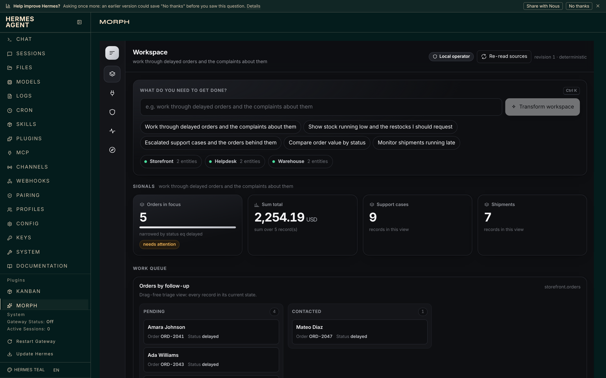

# MORPH

**Software that adapts to you.**

MORPH is a native [Hermes Agent](https://hermes-agent.nousresearch.com) plugin that
turns the applications you use into one adaptive workspace. State a goal and it composes
an interface for it from live schemas and live data — and lets the agent act there
without acting alone: the agent can read everything and *propose* changes, you approve
each one seeing exactly what will change, and MORPH reads the record back from the API
to prove it landed.

```bash
hermes morph connect github your-name/your-repo
```

```
you    › close the stale issues nobody has answered since spring, label them "stale"
hermes › I've proposed 6 changes. Nothing is applied until you approve them.
```

Six cards appear under **Approvals**, each with the before and after. Approve them and
each is written, re-read from GitHub and marked *verified* — or *unverified*, if what
came back is not what was promised. The agent has no tool that approves, and is never
given the token an approval needs.

It is not GitHub-specific. Point it at any service that publishes an OpenAPI document
and it derives what can be read and what can be safely changed from the schema alone.

<sub>Verified on Hermes Agent v0.23.0 · 243 unit/integration tests · 39 browser checks ·
<code>hermes plugins validate</code> clean · MIT</sub>



<sub>A change waiting for a person, in the real Hermes dashboard. Shown with the offline
sandbox connected; a GitHub repository looks the same, with issues in place of orders.</sub>

---

## Contents

1. [Why](#why)
2. [Quick start](#quick-start)
3. [Try it offline](#try-it-offline) — no account, no token
4. [Using it](#using-it) — dashboard, terminal, chat, agent tools
5. [Connect anything else](#connect-anything-else)
6. [How it works](#how-it-works)
7. [Safety model](#safety-model)
8. [What has been verified](#what-has-been-verified)
9. [Development](#development)
10. [Troubleshooting](#troubleshooting)
11. [Limitations](#limitations)

---

## Why

Giving an agent a write-capable API token is all-or-nothing. Either it cannot change
anything, or it can change everything the token can, and you find out afterwards — from
a message in which the agent tells you it went fine.

MORPH splits that in three:

| | Who | What stops it going wrong |
|---|---|---|
| **Propose** | the agent | Only operations with a stated, checkable effect exist. Preconditions and your role are checked before a proposal is even queued. |
| **Approve** | a person | Dashboard or an interactive terminal only. No agent tool approves; a hook blocks any `morph_` tool MORPH did not register. |
| **Verify** | MORPH | The record is re-read from the API and compared field by field with what was promised. Anything else is reported as `unverified`, never as success. |

Everything is written to a hash-chained log, so "who approved what, and did it really
happen" has an answer later.

### Why a plugin, and not a prompt or a skill

A prompt cannot hold a credential, mount a dashboard tab, keep a tamper-evident log
across sessions, or stop the agent approving its own write. MORPH needs all four, so it
uses every surface Hermes offers: **7 tools**, **3 lifecycle hooks**, a **dashboard
tab**, a **`/morph` slash command**, a **`hermes morph` CLI**, a **system prompt
section**, and **3 bundled skills**.

---

## Quick start

```bash
git clone https://github.com/timioni001/morph-hermes && ln -s "$PWD/morph-hermes" ~/.hermes/plugins/morph
```

```bash
hermes plugins validate ~/.hermes/plugins/morph && hermes plugins enable morph
```

```bash
hermes morph connect github your-name/your-repo
```

`connect` checks the repository answers before saving anything; if it does not, nothing
is changed. With no `GITHUB_TOKEN` in your Hermes environment a public repository is
connected **read-only** — you can look, and MORPH offers no operations. Add a token with
access to the repository's issues and the operations appear:

| Operation | What it promises |
|---|---|
| `close_issue` / `close_as_not_planned` / `reopen_issue` | `state`, `state_reason` |
| `set_labels` | the whole label list, exactly |
| `set_title` | `title` |
| `assign_to_me` / `unassign` | `assignee` |

MORPH stores the *name* of the variable, never the token, and reads it through Hermes's
own secret scope at call time.

Then open the dashboard and pick **MORPH** under *Plugins*:

```bash
hermes dashboard
```

Ask the agent for something in chat — *"triage the open issues: close the duplicates as
not planned and assign the bugs to me"* — and approve what it proposes.

### Turn the AI planning on
### Turn the AI planning on

MORPH plans with whatever model Hermes is configured to use, and falls back to a
deterministic composer when there is none. A fresh Hermes has no model, so workspaces
report `deterministic` until you log in — free, OAuth, no API key:

```bash
hermes setup --portal
```

```bash
hermes morph goal "open bugs nobody is assigned to"
```

The workspace header changes from *"Planned deterministically, with no model involved"*
to *"Planned by the host model"*. `model-repaired` means the model's first plan failed
schema validation and the repair pass fixed it — that is the recovery path working, and
it still counts.

---

## Try it offline

No GitHub token, no Hermes, no network. MORPH ships a sandbox: three small services
(a storefront, a helpdesk, a warehouse) with their own databases and HTTP APIs, so the
whole propose → approve → verify loop — including joins *across* services — can be
exercised on loopback.

```bash
make install
```

```bash
make demo
```

`make demo` is an acceptance test: it starts the services, has the agent propose a
change, shows the agent **refused** when it tries to approve, has an operator approve,
then reads the change back out of the owning service's own API. It exits non-zero if any
of that does not hold. `make serve` leaves it all running with the dashboard at
<http://localhost:8820>.

Inside Hermes the same sandbox is one command, and `up` starts it:

```bash
hermes morph connect sandbox && hermes morph up
```

---

## Using it

### The dashboard — five views

| View | Answers |
|---|---|
| **Workspace** | What am I working on? The composed interface, live. |
| **Connections** | What am I connected to, what can it do, and what may *I* do there? |
| **Approvals** | What needs a person? Each with the before/after the source itself promised. |
| **Activity** | What happened, with the evidence, and is the log intact? |
| **Context** | What did MORPH think I asked for, and what carried across the last transformation? |

The interface is composed from these blocks: metrics, searchable and sortable tables,
bar/line/donut charts, a kanban board grouped by a dimension the application lets you
*change*, timelines, detail panes, forms, contextual actions, cross-application relation
views and workflow notes. White-dominant, with a near-black accent; it reads the host's
background and follows its theme.

### From the terminal

```bash
hermes morph connect github owner/name   # connect a repository (probed before it is saved)
hermes morph connect openapi <base-url>  # connect any service with an OpenAPI document
hermes morph connect sandbox             # the offline practice services; then `hermes morph up`
hermes morph connections                 # what is connected and what may be proposed there
hermes morph disconnect <id>
hermes morph status                      # connections, workspace, pending approvals
hermes morph discover                    # the full capability graph and your permissions
hermes morph goal "open bugs nobody is assigned to"
hermes morph state                       # the workspace with live values
hermes morph proposals                   # what is waiting for a human
hermes morph approve <proposal-id>       # interactive only: refuses without a terminal
hermes morph reject <proposal-id>
hermes morph verify <proposal-id>        # re-read the source and check
hermes morph refresh                     # what changed since the last read
hermes morph audit                       # the hash-chained log, verified
hermes morph doctor                      # configuration, reachability, storage, credentials
hermes morph reload                      # re-read configuration, rebuild connectors
```

Add `--json` to any of them for machine-readable output.

### In a chat

```
/morph                       status
/morph pending               what is waiting for a human
/morph goal <what you need>  recompose the workspace
```

### The tools the agent gets

| Tool | What it does |
|---|---|
| `morph_discover` | Applications, entities, fields, operations, cross-application links, health, and this caller's permissions. |
| `morph_plan_workspace` | A goal becomes a validated workspace; an existing one is transformed, carrying context. |
| `morph_workspace_state` | The workspace with live values, pending approvals, failures and the audit tail. |
| `morph_refresh` | Re-read every source and report what moved. |
| `morph_inspect_record` | One record straight from its own application, with the operations that could be proposed against it. |
| `morph_propose_action` | Queue one write for a human. Applies nothing. |
| `morph_verify_action` | Re-read the record and say whether the change actually landed. |

There is deliberately no eighth tool. The agent cannot approve its own proposal, is never
handed the confirmation token an approval requires, and a `pre_tool_call` hook blocks any
tool in the `morph_` namespace that MORPH did not register — so the guarantee does not
depend on nobody ever adding one.

### Bundled skills

`morph:triage`, `morph:connect-an-application`, `morph:verified-change` — how
the agent learns MORPH's discipline (propose, wait, verify) without that discipline
having to fit in a tool description.

---

## Connect anything else

MORPH is not written against any particular API. There are four adapters:

| Kind | What the service must provide | Use it for |
|---|---|---|
| **`github`** | — | a repository's issues and pull requests |
| **`openapi`** | an OpenAPI 3 document | **anything** — nothing MORPH-specific at all |
| **`http-rest`** | a `morph.source.v1` descriptor | a service you control, described exactly |
| **`memory`** | — | an in-process fixture, for tests |

### `openapi` — the general case

Point it at the document a service already publishes:

```bash
hermes morph connect openapi https://api.example.com --token-env FIELDWORK_TOKEN
```

It looks for the shape almost every REST API already has — `GET /things`,
`GET /things/{id}`, and `PATCH` or `PUT` on the second — and derives the entities, their
fields and their operations from the schema, following `$ref`, `allOf` and `anyOf`. If
the listing lives somewhere else, it is found by matching the response schema rather than
the path.

**Operations are derived, never invented.** MORPH's contract is that an operation states
what it will change, so the change can be verified by re-reading the record. An `enum`
becomes one operation per value; a boolean becomes a matched set/clear pair; every other
writable field becomes one operation that takes the value as a parameter. `readOnly`
fields, identifiers and version fields never become operations at all.

Try it against a real third-party API, no account needed:

```bash
python scripts/check_openapi_connector.py
```

That reads the public Swagger Petstore, derives its `pet` entity, finds the listing at
`/pet/findByStatus`, lists its live records and reads one back — and offers **no
operations at all**, because the Petstore's update is a `PUT` on the collection rather
than on one record, so MORPH cannot verify what it would leave behind. Declining is the
feature.

### `http-rest` — an application you control

Publish a `morph.source.v1` descriptor at `/morph/schema` and you get exact control over
entity labels, field roles, enum domains, operation effects, preconditions and risk.
`docs/CONNECTORS.md` has the full contract, a worked example of writing an adapter by
hand, and what the GitHub connector does when a vendor provides none of it.

### Configuration

`connect` writes `<plugin data dir>/config.json`. You can edit that file by hand — to
declare a join between two services, or per-role permissions — or replace it wholesale
with `MORPH_CONFIG_FILE` or Hermes's own plugin config. An install with no configuration
is connected to nothing.

| File | Shows |
|---|---|
| `config/connectors.github.example.json` | a GitHub repository |
| `config/connectors.openapi.example.json` | any OpenAPI service |
| `config/connectors.sandbox.json` | three services, the joins between them, and a role |

---

## How it works

```
goal ─► interpret ─► capability graph ─► plan ─► validate ─► resolve ─► render
                      (schema only)       │                    (live)
                                          └─ repair once, else deterministic floor

action ─► propose ─► human approves ─► write (If-Match + idempotency key)
                                           └─► re-read from source ─► compare ─► audit
```

| Stage | What happens |
|---|---|
| **Discover** | Each connector introspects a live schema: entities, field types, enum domains, declared operations with their parameters, effects, preconditions and risk. |
| **Graph** | Schema only, no record values. Intra-application relationships come from the applications; cross-application links are declared by the operator. |
| **Interpret** | A dedicated stage reads *what kind of work* is being asked for (review, analyse, monitor, act), which entities and why, which filters the words imply — and says what it could **not** cover, including an operation your role may not run. |
| **Plan** | Goal, graph and reading go to the host model through `ctx.llm` with a JSON schema. Validation errors are fed back for one repair attempt. A relevance-scoring composer is the floor and runs unchanged with no model at all. |
| **Validate** | `morph.ui.v1` can only name entities, fields, enum values, relationships and operations that exist. No field anywhere can hold markup, a URL or an expression. |
| **Resolve** | One pass, deduplicated reads, in-process aggregation, cross-application joins, per-block error isolation, and a `degraded` flag when something is missing. |
| **Sync** | Each application publishes a change feed; MORPH keeps a cursor, so a refresh is one small call per application and it catches edits made **directly in the source system**, attributed to whoever made them. Signature diffing is the floor for sources with no feed. |
| **Execute** | Propose → human approves → write with `If-Match` and an idempotency key → re-read from the source → compare with what the operation promised. Anything less is reported as `unverified`, never as success. |
| **Audit** | Every proposal, approval, rejection, failure and composition is hash-chained; the Activity view verifies the chain and shows the evidence behind each action. |

### Layout

```
__init__.py       register(ctx): tools, hooks, CLI, slash command, prompt section, skills
morph/
  intent.py       what kind of work the goal describes, and what it could not cover
  planner.py      model call, schema repair, deterministic composer
  uischema.py     morph.ui.v1 — the only shapes a workspace may contain
  resolve.py      the plan against live data, with joins and per-block isolation
  engine.py       compose, transform, propose, approve, verify
  actions.py      principals, roles, the approval boundary
  store.py        workspace revisions, proposals, hash-chained audit
  sync.py         cursors and change feeds
  connect.py      hermes morph connect / disconnect / connections
  launch.py       hermes morph up (starts the sandbox)
  connectors/     the adapter contract and the four adapters
apps/             the offline sandbox: three small independent services
dashboard/        the plugin's tab: manifest, plugin_api.py, src/, dist/
skills/           three workflow guides
```

---

## Safety model

- **The agent can propose; only a human can approve.** The confirmation token is never
  given to an agent principal, and a `pre_tool_call` hook enforces the tool namespace.
- **Every write is verified.** `If-Match` optimistic concurrency, an idempotency key, and
  a re-read of the record compared against what the operation promised.
- **Scoped credentials.** Tokens are read through `agent.secret_scope.get_secret` at call
  time, honouring the active profile, and are never logged, stored or returned. MORPH
  never reads `.env`, `auth.json` or any other credential store itself.
- **SSRF defence.** Connector hosts are allowlisted and resolved addresses re-validated at
  connect time, so a hostname that resolves to a private or loopback address is refused
  unless loopback was opted into. No redirects are followed; responses are capped.
- **Nothing is atomic across applications**, and MORPH never claims otherwise: a batch
  reports per-record outcomes.
- **Tamper-evident audit.** Hash-chained; a removed or edited entry shows up.

### Disclosures

- **Third-party network calls** — the applications you configure, and `api.github.com`
  when a GitHub connector is configured. Nothing else.
- **Background processes** — none unless you connect the sandbox; then `hermes morph up`
  starts its three services on loopback. It starts nothing else, ever.
- **Stored credentials** — MORPH's configuration holds variable *names* only. For the
  sandbox, `up` asks Hermes to store the practice services' generated tokens through the published `save_env_values` helper. Outside Hermes it stores nothing
  and prints the variables for you to export.
- **Reads outside its own data** — none. State lives in the plugin data directory.
- **Telemetry** — none, of any kind.

---

## What has been verified

Claims split by how they were checked, because "it works" means different things for a
suite that executes and a contract that was read.

### Run, and passing

- Three applications, each with its own SQLite database, bearer token and HTTP API,
  started as independent processes.
- **243 Python tests** — unit, integration against those running services, and security.
- **39 browser checks** in Chromium against the committed bundle and the live API,
  including two mobile viewports.
- **`make demo`** end to end: discovery, composition, the agent proposing, the agent
  **refused** when it tries to approve, a human approving, the write applied, the record
  re-read from the owning application's own API, the audit chain verified.
- **Installed into a real Hermes Agent v0.23.0.** `hermes plugins doctor` reports 7 tools
  and 3 hooks; `hermes plugins validate` passes every check with `security scan — safe`
  and no cautions; `hermes morph doctor` finds all three applications reachable with the
  plugin data directory writable.
- **`hermes morph connect` in that same Hermes**: `connect sandbox` then `up` brought
  three services up and `doctor` reported healthy; `connect github` against the real
  GitHub API connected a public repository read-only with no token, and a repository
  that does not answer was refused with the configuration left untouched.
- **The MORPH tab renders in the real Hermes web dashboard** — in the navigation under
  Plugins, mounted through the host's own `window.__HERMES_PLUGIN_SDK__`, API served from
  `/api/plugins/morph/`, live values from all three applications, no console errors.
- **The OpenAPI adapter against the public Swagger Petstore**: document read, entity
  derived, listing found by schema, live records listed and one read back.
- **The GitHub connector against the real GitHub API**: authenticated, schema introspected
  from live data, change feed run twice, a workspace composed, a proposal built then
  rejected without writing anything.

### The whole loop, live, against GitHub

Run on 9 November 2026 against the public scratch repository
[`Timioni001/morph-demo`](https://github.com/Timioni001/morph-demo/issues), ten seeded issues:

- **A real Hermes agent proposed.** `hermes chat` on a free Nous Portal model called
  `morph_discover`, read the issues with `morph_inspect_record`, and queued four changes
  with `morph_propose_action`: close #3 and #6 as not planned (duplicates of #1), retitle
  #7, assign #1. Its reply said they were waiting for approval. GitHub still showed ten
  open, none closed.
- **A person approved** each one in the MORPH tab of the Hermes dashboard.
- **MORPH wrote and verified.** Each proposal ended `applied` with `verified: true` after
  re-reading the issue; the same four changes were then confirmed separately through the
  GitHub REST API and on github.com.
- **Model-planned workspace.** The workspace for *"Triage the open issues"* was composed
  by that model (`mode: model`). It is a small model and left blocks half-filled; MORPH
  keeps the blocks that validate, drops the rest and says how many. A second goal failed
  validation twice and fell back to the deterministic composer, which is the floor
  working as designed. Plan quality follows the model.

### Covered by tests, not run live

- **`set_labels` and `unassign` on GitHub**, and writes through the **OpenAPI** adapter.
  The four operations above ran against the real API; these are covered by tests with a
  recorded transport. The OpenAPI adapter was run live read-only against the public
  Swagger Petstore.

---

## Development

```bash
make install     # create .venv and install the dev extra
make test        # the Python suite
make e2e         # the browser suite (needs Node and Playwright)
make demo        # end-to-end acceptance
make serve       # applications + dashboard, left running
make bundle      # check the committed bundle matches its sources
make validate    # the Hermes plugin checks
make check       # what CI runs
make clean       # remove .venv, caches and test artefacts
```

Every target runs through `.venv/bin/python`, so it behaves the same whether or not you
activated the virtual environment in this particular shell.

The dashboard bundle is plain JavaScript concatenated by `scripts/build_dashboard.mjs` —
no bundler, no build step to trust. Edit `dashboard/src/*.js` and re-run it.

MORPH has **no Python dependencies of its own**; it uses what Hermes already ships. The
dev extra is for the tests and the demo.

---

## Troubleshooting

| Symptom | Fix |
|---|---|
| `error: externally-managed-environment` | `make install` — it never needs a virtual environment activated |
| `No module named 'fastapi'` | `make install` |
| `pytest` errors mention `/usr/lib/python3.x` | a system `pytest` is on `PATH`; use `make test` |
| `port 8811 is already in use` | `pkill -f 'uvicorn apps\.'` |
| `HTTP Error 401` from the demo | stale applications holding the ports; same `pkill`, then re-run |
| Workspace says `deterministic` | no model configured — [see above](#turn-the-ai-planning-on) |
| `Nothing is connected` | `hermes morph connect github owner/name`, or `connect sandbox` |
| GitHub connected but no operations offered | no `GITHUB_TOKEN` in the Hermes environment, or `--read-only` |
| Connector says it needs a credential | export the variable the connector names; for the sandbox, `hermes morph up` |

`docs/WSL.md` is a full runbook for Windows/WSL2, including reclaiming disk.

### More documentation

| | |
|---|---|
| `docs/ARCHITECTURE.md` | the eight stages in detail |
| `docs/CONNECTORS.md` | the adapter contract and worked examples |
| `docs/SECURITY.md` | the threat model and what is enforced where |
| `docs/DEMO.md` | what the offline sandbox run proves, step by step |
| `docs/SUBMISSION.md` | the catalog PR, step by step |
| `docs/WSL.md` | Windows/WSL2 runbook |

---

## Limitations

- Per-user roles come from the dashboard session identity Hermes provides; with the
  dashboard on loopback and no auth gate engaged, every local caller is the configured
  default operator. Map identities to roles under `user_roles` when running with auth.
- The sandbox services exist to exercise MORPH offline. They are real processes with
  real databases and HTTP APIs, and they are not a product.
- The GitHub connector covers issues and pull requests as issues, and offers only
  operations whose effect can be verified by re-reading the issue. Posting a comment is
  deliberately absent: its effect is an increment, so MORPH could not prove the change
  it promised. Labels are set as a whole list for the same reason.
- The OpenAPI adapter claims no change feed, because a generic document declares none,
  and its optimistic concurrency is best-effort: an `ETag`, else a `version` field, else
  nothing — and it says so rather than implying a guarantee it cannot make.
- MORPH plans with whatever model Hermes is configured to use. Quality varies with it;
  the deterministic composer is the floor, not the ceiling.

---

## Licence

MIT. See [`LICENSE`](LICENSE).
