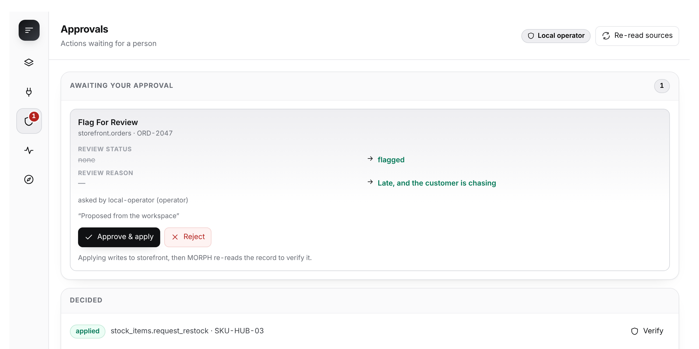
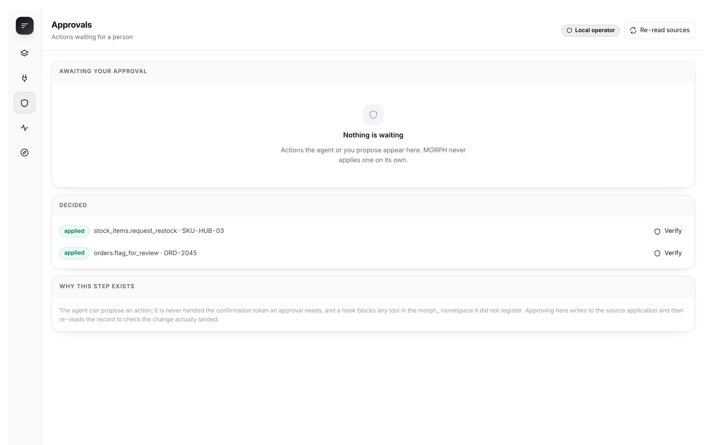
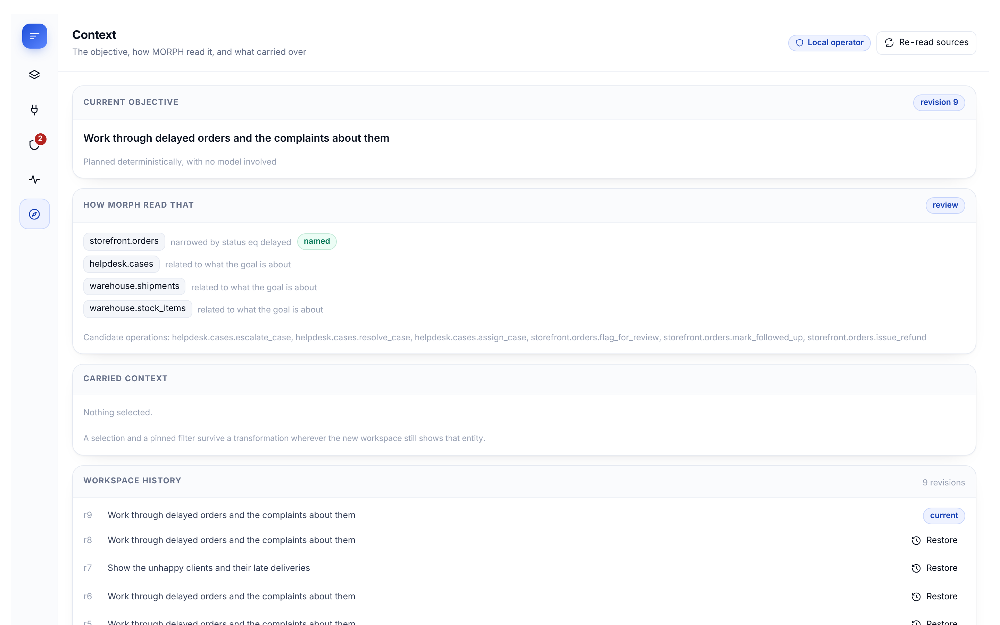

# MORPH

**Software that adapts to you.**

MORPH is a native [Hermes Agent](https://hermes-agent.nousresearch.com) plugin that turns
several independent applications into one workspace shaped around what you are trying to
get done — and lets you act on them from that workspace, with a human approving every
write and the result verified in the application that owns the record.

Tell it *"work through delayed orders and the complaints about them"*. MORPH reads the
schemas of the applications it is connected to, works out what that goal is actually
about, composes an interface from them, fills it with data read live from each
application, joins records across application boundaries, and offers only the actions
your role is permitted to take. Change the goal and the workspace changes with it,
carrying your selection and your filters over.

There is no layout in this repository. Every workspace is composed at request time from
whatever the connected applications happen to publish.

## Why this is a plugin, and not a prompt or a skill

A prompt can describe a dashboard. A skill can teach an agent a workflow. Neither can:

- **hold a capability graph** introspected from live third-party APIs, and refuse any
  plan naming a field or operation that is not in it;
- **enforce an approval boundary the model cannot cross** — the agent is never handed
  the confirmation token an approval requires, and a `pre_tool_call` hook closes the
  `morph_` namespace so no other plugin can hand it one;
- **write to a system of record** with optimistic concurrency and an idempotency key,
  then **re-read it and compare against what the operation promised** before anyone is
  told it worked;
- **keep a hash-chained audit log** that detects its own tampering;
- **see a change someone else made** in the source application and reconcile it.

All of that is server-side state and authority. It is the part of the problem a prompt
cannot reach.

> If you are looking at this next to a generative-UI plugin: those draw the answer.
> MORPH operates the systems. The demo is not a rendered chart — it is an order that is
> actually flagged in the Storefront, with the Storefront's own changelog showing who
> approved it.

### What it connects to

MORPH is not written against any particular application. There are four adapters, and
the demo applications are only the first of them:

| Kind | What the application has to provide | What it is for |
|---|---|---|
| `openapi` | an OpenAPI 3 document | **anything.** Nothing MORPH-specific at all |
| `http-rest` | a `morph.source.v1` descriptor | an application you control, described exactly |
| `github` | — | a hand-written adapter for one vendor's API |
| `memory` | — | an in-process fixture, for tests |

`openapi` is the general case. Point it at the document a service already publishes and
it derives the entities, their fields and the operations from the schema — a service
whose authors have never heard of MORPH, driven by it:

```
Fieldwork — Scheduling for field engineers.
entity jobs (key id, title reference)
   W status          enum   ['scheduled', 'en_route', 'on_site', 'complete']
   W requires_parts  bool
  · set_status_complete     Status: Complete    effect={'status': 'complete'}  unless: status is already 'complete'
  · set_requires_parts      Set requires parts  effect={'requires_parts': True}  unless: requires parts is already set
```

Operations are derived, never invented. MORPH's contract is that an operation states
what it will change so the change can be verified by re-reading the record afterwards,
so an `enum` becomes one operation per value, a boolean becomes a matched pair, and
every other writable field becomes one operation that takes the value as a parameter.
A `readOnly` field, an identifier and a version field never become operations at all.
The result is a vocabulary a person can read instead of one "update this record" verb
that could do anything.

Run it against a real third-party API yourself — public, no account, no key:

```bash
python scripts/check_openapi_connector.py
```

That reads the Swagger Petstore, which is nobody's idea of a tidy REST API, and that is
the point. It has no `GET /pet`, so the listing is found by matching the response schema
instead (`/pet/findByStatus`), and its update is a `PUT` on the collection rather than
the record — so MORPH reads 44 live pets and offers **no operations at all**, because
nothing there can be changed in a way it could verify afterwards. Declining is the
feature.

The **GitHub connector** is the other end of the range — an adapter written by hand
against an API nobody controls. GitHub publishes no MORPH schema, no version field, no
idempotency header and no change feed in the shape MORPH asks for, and it still slots in
as one more application in the graph: optimistic concurrency derived from `updated_at`,
idempotency enforced on MORPH's side, incremental reads as its change feed.

Three demo applications ship with MORPH so the whole thing is reproducible with no
account and no key. See `docs/CONNECTORS.md`.



<p align="center">
  
  
</p>

---

## What it does, concretely

| | |
|---|---|
| **Discovers applications** | Each connector introspects a live schema: entities, field types, enum domains, declared operations with their parameters, effects, preconditions and risk. |
| **Builds a capability graph** | Schema only — no record values. Intra-application relationships come from the applications; cross-application links are declared by the operator, and MORPH traverses both. |
| **Interprets the goal** | A dedicated stage reads *what kind of work* is being asked for (review, analyse, monitor, act), which entities it is about and why, which filters the words imply — and says out loud what it could **not** cover, including an operation that exists but your role may not run. |
| **Plans an interface** | The goal, the graph and that reading go to the host model through `ctx.llm` with a JSON schema. The result is validated; validation errors are fed back for one repair attempt; a relevance-scoring composer is the floor, and runs unchanged with no model at all. |
| **Validates the plan** | `morph.ui.v1` can only name entities, fields, enum values, relationships and operations that exist. No field anywhere in the schema can hold markup, a URL or an expression. |
| **Renders something usable** | Metrics, sortable and searchable tables, charts, a kanban board grouped by a dimension the application lets you *change*, timelines, detail panes, forms, contextual actions and cross-application relation views. |
| **Resolves it live** | One pass, deduplicated reads, in-process aggregation, cross-application joins, per-block error isolation and a `degraded` flag when something is missing. |
| **Stays in sync both ways** | Each application publishes a change feed; MORPH keeps a cursor, so a refresh is one small call per application and it catches edits made **directly in the source system**, attributed to whoever made them. Signature diffing is the floor for sources with no feed. |
| **Executes, carefully** | Propose → human approves → write with `If-Match` and an idempotency key → re-read the record from the source → compare with what the operation promised. Anything less is reported as `unverified`, never as success. |
| **Keeps a tamper-evident log** | Every proposal, approval, rejection, failure and composition is hash-chained; the Activity view verifies the chain and shows the evidence behind each action. |

## Five surfaces

MORPH is one dashboard tab with five views, because they answer five different questions:

| View | Answers |
|---|---|
| **Workspace** | What am I working on? The composed interface, live. |
| **Connections** | What am I connected to, what can it do, and what may *I* do there? |
| **Approvals** | What needs a person? Each with the before/after the source itself promised. |
| **Activity** | What happened, with the evidence, and is the log intact? |
| **Context** | What did MORPH think I asked for, and what carried across the last transformation? |

---

## Quick start

```bash
git clone https://github.com/timioni001/morph-hermes
cd morph-hermes
```

MORPH has no Python dependencies of its own — it uses what Hermes already ships. To run
it outside Hermes (tests, the demo, the dashboard harness):

```bash
make install          # creates .venv and installs the dev extra
```

Every `make` target runs through `.venv/bin/python`, so it behaves the same whether or
not the virtual environment is activated in your current shell.

Then run the whole showcase in one command:

```bash
make demo
```

It starts three independent applications, composes a workspace from a goal, has the agent
propose an action, shows the agent refused when it tries to approve, has an operator
approve it, and then reads the change back out of the source application's own API. It
exits non-zero if any of that does not hold, so it is an acceptance test as much as a
demonstration. `make serve` leaves everything running and opens the dashboard.

### A recorded run

```bash
scripts/make_video.sh      # → .media/morph-demo.mp4  (~43s, needs ffmpeg + playwright)
```

Playwright drives a real browser through the whole sequence — compose, select,
propose, approve, then reload the Storefront's own page to show the change and the
version bump. The only thing added afterwards is the caption text, from timings the
recorder wrote while it ran. The file is not committed; the script regenerates it.

---

## Installing it into Hermes

```bash
# 1. put the plugin where Hermes looks for one
ln -s "$PWD" ~/.hermes/plugins/morph       # or: cp -r . ~/.hermes/plugins/morph

# 2. check it against the real runtime contracts
hermes plugins doctor ~/.hermes/plugins/morph --ci
hermes plugins validate ~/.hermes/plugins/morph

# 3. plugins are opt-in
hermes plugins enable morph

# 4. the dashboard tab is mounted when the dashboard starts
hermes dashboard
```

MORPH then appears as a **MORPH** tab in the Hermes web dashboard, and registers seven
tools in the `morph` toolset, three lifecycle hooks, a `/morph` slash command and a
`hermes morph` CLI subcommand.

Connect it to something. Out of the box it is wired to the three bundled demo
applications on loopback; `docs/CONNECTORS.md` covers pointing it at your own services,
and `config/connectors.default.json` is the file to copy.

### The tools Hermes gets

| Tool | What it does |
|---|---|
| `morph_discover` | Applications, entities, fields, operations, cross-application links, health, and this caller's permissions. |
| `morph_plan_workspace` | A goal becomes a validated workspace; an existing one is transformed, carrying context. |
| `morph_workspace_state` | The workspace with live values, pending approvals, failures and the audit tail. |
| `morph_refresh` | Re-read every source and report what moved. |
| `morph_inspect_record` | One record straight from its own application, with the operations that could be proposed against it. |
| `morph_propose_action` | Queue one write for a human. Applies nothing. |
| `morph_verify_action` | Re-read the record and say whether the change actually landed. |

There is deliberately no eighth tool. The agent cannot approve its own proposal, is never
handed the confirmation token an approval requires, and a `pre_tool_call` hook blocks any
tool in the `morph_` namespace that MORPH did not register — so the guarantee does not
depend on nobody ever adding one.

---

## From the terminal

```bash
hermes morph up                          # start the bundled applications, wire their tokens
hermes morph status                      # applications, workspace, pending approvals
hermes morph discover                    # the full capability graph and your permissions
hermes morph goal "delayed orders and the complaints about them"
hermes morph state                       # the workspace with live values
hermes morph proposals                   # what is waiting for a human
hermes morph approve <proposal-id>       # interactive only: refuses without a terminal
hermes morph verify <proposal-id>        # re-read the source and check
hermes morph refresh                     # what changed since the last read
hermes morph audit                       # the hash-chained log, verified
hermes morph doctor                      # configuration, reachability, storage, credentials
```

---

## How it is put together

```
morph/
  config.py       configuration, secret access, network policy
  registry.py     connector instances and health
  connectors/     the adapter contract, the HTTP adapter, an in-process fixture,
                  and the connect-time SSRF guard
  capability.py   the capability graph (schema only)
  planner.py      model planning, repair, and the deterministic composer
  uischema.py     morph.ui.v1 and its validator
  resolve.py      live resolution, aggregation, joins, change detection
  actions.py      principals, permissions, proposals, approval, verification
  store.py        MORPH's own SQLite: workspaces, revisions, proposals, audit chain
  workspace.py    revisions and context preservation
  engine.py       the façade every surface goes through
  tools.py        the Hermes tool handlers
  cli.py          hermes morph
dashboard/        manifest, FastAPI routes, and the plugin bundle (src/ → dist/)
apps/             three independent demo applications
demo/             the reproducible showcase
docs/             architecture, connectors, security, demo
```

`docs/ARCHITECTURE.md` explains the pipeline and the decisions behind it.

---

## Tests

```bash
make test        # 176 tests: unit, integration against the real services, security
make e2e         # 39 browser checks, Chromium, the real bundle and the real API
make bundle      # the committed bundle matches its sources
make validate    # the Hermes catalog admission checks
```

The integration tests start the three demo applications as real subprocesses on their own
ports and assert against their HTTP APIs, including: an approved action landing in the
source system, optimistic concurrency voiding a stale proposal, one application going
down without taking the workspace with it, an edit made **outside** MORPH being detected
and attributed, and change detection naming the record that moved. The security tests
cover the network policy, read-only connectors, retry and rate-limit behaviour, the
authority boundary, hostile schema text, and the refusal of anything the capability graph
does not contain.

---

## Security posture

The long version is `docs/SECURITY.md`. The short version:

- **An agent can propose; only a person approves.** Authority is carried on the principal,
  not in a request body, and the agent role cannot be granted approval by configuration.
- **Nothing from a model is executed.** A plan is data naming things that already exist.
- **Nothing from an application is an instruction.** Schema text is flattened and capped
  before it is stored, rendered or put in a prompt; record values never reach a prompt at
  all.
- **Writes are optimistic, idempotent and verified.** Version mismatch voids a proposal; a
  repeated key replays rather than reapplies; success means the record was re-read and
  matched.
- **Egress is narrow.** HTTPS only (loopback needs an explicit opt-in), an optional host
  allowlist, no redirects, response caps, and connect-time validation of the address
  actually dialled. A connector can be marked `read_only`, which no role overrides.
- **Retries are safe ones.** Reads retry with backoff; a write retries only because it
  always carries an idempotency key. `429` waits for `Retry-After`.
- **Credentials are Hermes's.** A connector names an environment variable; the value is
  read through `agent.secret_scope` and never logged, stored or returned.
- **Nothing is atomic across applications**, and MORPH never claims otherwise: a batch
  reports each item separately.

## Disclosures

Catalog rule 13 asks for what a user would want to know before installing. In full:

- **Network calls to third-party services.** MORPH talks to whatever applications
  you configure, over HTTP, and to `api.github.com` when a GitHub connector is
  configured. It calls nothing else. Hosts are checked against an allowlist and
  resolved addresses are re-validated at connect time, so a hostname that resolves
  to a private or loopback address is refused unless you opted into loopback.
- **Long-running background processes.** `hermes morph up` starts the three
  demonstration applications bundled with MORPH, as child processes on loopback.
  It starts nothing else, ever: an application MORPH did not ship is reported and
  left alone. Without `--detach` they stop when you press Ctrl-C.
- **Stored credentials.** Connector tokens are read through
  `agent.secret_scope.get_secret`, which honours the active profile; outside
  Hermes MORPH falls back to the process environment. MORPH never reads `.env`,
  `auth.json` or any other credential store itself. `up` asks Hermes to store the
  demonstration applications' generated tokens through the published
  `save_env_values` helper; outside Hermes it stores nothing and prints the
  variables for you to export.
- **Reads outside its own data.** None. State lives in the plugin data directory
  Hermes assigns.
- **Telemetry.** None, of any kind.
- **Writes to your systems.** Only through an operation you approve in the
  dashboard, with the change re-read from the source afterwards to confirm it.
  The agent cannot approve its own proposal.

## Running it on WSL

`docs/WSL.md` is the exact command list, including installing into a real Hermes.

## What has been run, and what has not

Claims below are split by how they were checked, because "it works" means different
things for a suite that executes and a contract that was read.

**Run, and passing**

- Three applications, each with its own SQLite database, its own bearer token and its
  own HTTP API, started as independent processes.
- 176 Python tests: unit, integration against those running services, and security.
- 39 browser checks in Chromium, driving the committed bundle against the live API,
  including two mobile viewports.
- `demo/run_demo.py` end to end: discovery, composition from a goal, the agent
  proposing, the agent **refused** when it tries to approve, a human approving, the
  write applied with `If-Match` and an idempotency key, the record re-read from the
  owning application's own API, and the hash-chained audit log verified. It exits
  non-zero if any step does not hold.
- The GitHub connector against the real GitHub API: authenticated, schema introspected
  from live data, the change feed run twice, a workspace composed, and a proposal built
  then rejected without writing anything.
- The OpenAPI adapter against the public Swagger Petstore: the document read, one entity
  derived, its listing endpoint found by schema, 44 live records listed and one read back
  — reproducible with `python scripts/check_openapi_connector.py`.
- `hermes plugins doctor . --ci` and `hermes plugins validate .` against the Hermes CLI
  built from a clone of `hermes-agent` — security scan clean, validation passed.

**Implemented against the published contract, not observed in a live install**

- *The dashboard tab.* The browser suite drives the real bundle through a harness that
  implements the documented Hermes dashboard SDK — `window.__HERMES_PLUGIN_SDK__`,
  `window.__HERMES_PLUGINS__.register()`, and the plugin router mounted at
  `/api/plugins/morph/`. The plugin has not been rendered inside the Hermes web app
  itself. Every machine available for this build was short of the disk and memory a
  full Hermes install needs.
- *Model-backed planning.* `plan()` calls `ctx.llm.complete_structured`, validates the
  result against `morph.ui.v1`, repairs once on failure, and falls back to the
  deterministic composer. Every run recorded here reports `deterministic`, because no
  host model was configured. Five tests exercise the model path with a stub LLM —
  schema-only prompting, one repair attempt, and three distinct failure modes falling
  back rather than erroring — but it has not been watched against a live model.

**Not exercised against live data**

- GitHub issue reads. The connector authenticated and introspected against a real
  repository, but that repository had no open issues, so listing, reading and change
  detection are covered by 15 tests with a recorded transport rather than live traffic.

## Limitations

- Per-user roles come from the dashboard session identity Hermes provides; with the
  dashboard on loopback and no auth gate engaged, every local caller is the configured
  default operator. Map identities to roles under `user_roles` when running with auth.
- The bundled applications are demonstration systems. They are real services with real
  databases and real HTTP APIs, which is what makes the integration demonstrable — they
  are not a storefront. The GitHub connector talks to the real GitHub API; it is driven
  by a fake transport in CI and by `scripts/check_github_connector.py` against a real
  repository.
- The GitHub connector offers only operations whose effect can be verified by re-reading
  the issue. Posting a comment is deliberately absent: its effect is an increment, so
  MORPH could not prove the change it promised.
- MORPH plans with whatever model Hermes is configured to use. Quality varies with it; the
  deterministic composer is the floor, not the ceiling.

## Licence

MIT. See `LICENSE`.
