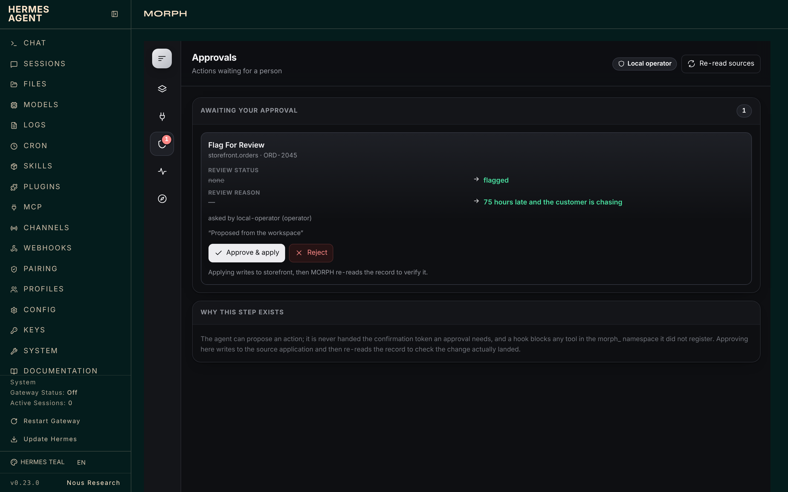
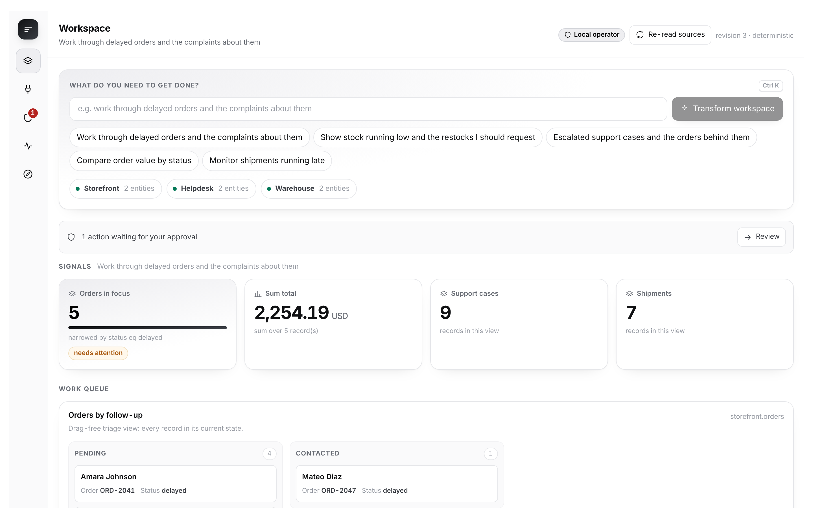
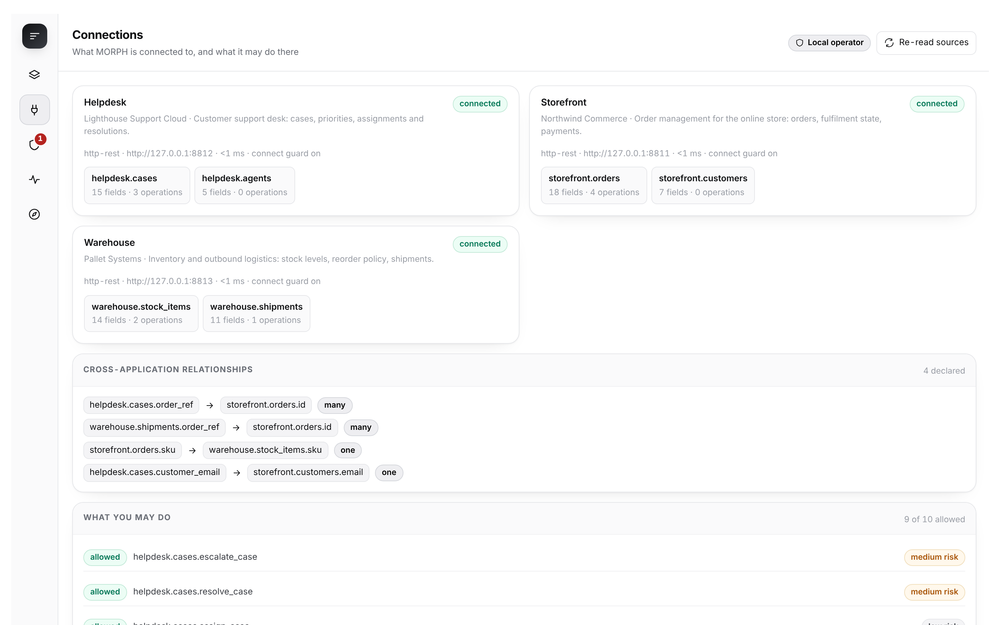
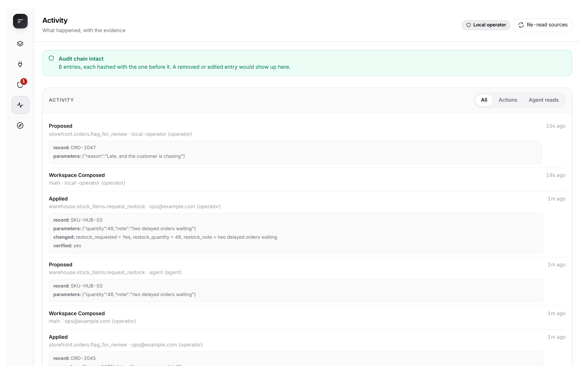

## What does this PR do?

Adds one catalog entry, `plugin-catalog/morph.yaml`, for **MORPH** — an approval gate
between the agent and the APIs it can write to.

Connect a GitHub repository (`hermes morph connect github owner/name`) or any service
that publishes an OpenAPI document. MORPH learns from the schema what can be read and
what can be safely changed. The agent gets tools to read and to *propose*; a person
approves each change in the dashboard, seeing the exact before and after; MORPH writes
it, then re-reads the record from the API and reports it verified only if it matches
what was promised. Every proposal, approval and result goes into a hash-chained log.

I am the owner of the plugin repository (rule 5). Pinned commit:
https://github.com/timioni001/morph-hermes/tree/<sha>

**Hermes surfaces used** — all public: 7 tools (`ctx.register_tool`), 3 hooks
(`on_session_start`, `pre_tool_call`, `post_tool_call`), a dashboard tab
(`dashboard/manifest.json` + `plugin_api.py`), a `/morph` slash command, a
`hermes morph` CLI command, a system prompt section and 3 skills. No middleware, no
Desktop plugin, no core overrides, no Python dependencies of its own.

**Disclosures (rule 13)**

- **Network** — outbound HTTPS only to the services the operator connects, including
  `api.github.com` when a repository is connected. Hosts are allowlisted; private,
  link-local, reserved and cloud-metadata addresses are refused and re-checked at
  connect time; loopback needs an explicit opt-in; redirects are never followed.
- **Credentials (rule 11)** — configuration stores environment-variable *names* only.
  Tokens are read with `agent.secret_scope.get_secret` at call time and never logged,
  stored or returned. MORPH never reads `.env`, `auth.json` or any credential store.
  For the optional offline sandbox, `hermes morph up` stores the practice services'
  locally generated tokens through the published `save_env_values` helper.
- **Approvals (rule 12)** — MORPH adds an approval step of its own and does not touch
  Hermes's. There is no tool that approves; the agent is never given the confirmation
  token; `hermes morph approve` refuses without an interactive terminal, so it cannot
  be driven from cron or the gateway.
- **Background processes** — none by default. Only if the operator runs
  `hermes morph connect sandbox` and then `hermes morph up`, three practice services
  bundled in the repository start on loopback.
- **Model use** — interface planning calls the host model through `ctx.llm` with schema
  only, never a record value, and falls back to a deterministic composer.
- **Stored data** — connection list, workspaces, pending proposals, read cursors and
  the audit log, all in the plugin data directory. Nothing is read outside it.
- **Telemetry** — none. **Shell commands** — none. **Self-updating code** — none.

## Related Issue

None — new catalog entry.

## Type of Change

- [x] ✨ New feature (non-breaking change that adds functionality)

## Changes Made

- `plugin-catalog/morph.yaml` — new entry, pinned to `<sha>`.

## How to Test

1. `git clone https://github.com/timioni001/morph-hermes && cd morph-hermes && git checkout <sha>`
2. `hermes plugins validate . --install-deps` — passes, `security scan — safe`.
3. `ln -s "$PWD" ~/.hermes/plugins/morph && hermes plugins enable morph`
4. `hermes morph connect sandbox && hermes morph up`, then `hermes dashboard` → **MORPH**.
   Propose a change from the Workspace view, approve it under **Approvals**, and see it
   verified. (Or `hermes morph connect github owner/name` with a `GITHUB_TOKEN`.)

Tested on Linux, Hermes Agent v0.23.0.

## Checklist

- [x] I searched existing PRs and catalog entries; there is no `morph` entry.
- [x] This PR contains only the one catalog file.
- [x] `hermes plugins validate --install-deps` passes at the pinned commit.
- [x] `requires_hermes` (`>=0.19`) is declared in both the entry and `plugin.yaml`.
- [x] The `capabilities:` block matches what the plugin registers at the pinned commit.

## Screenshots / Logs

